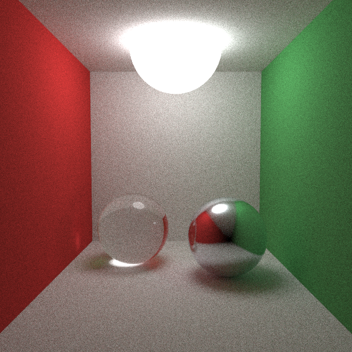
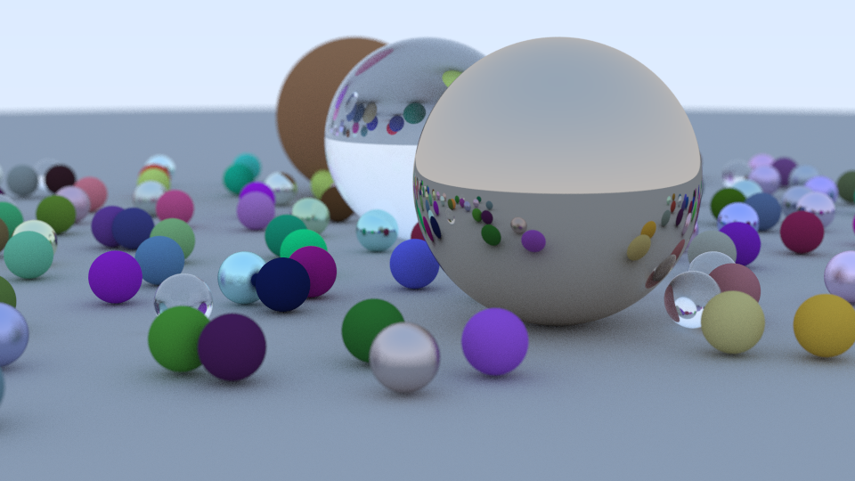

# tracer

[](https://github.com/zg/tracer/actions/workflows/ci.yml) [](https://pkg.go.dev/github.com/zg/tracer) [](LICENSE)

A path tracer. Ray tracing renders an image by following the path of light
as pixels in an image plane and simulating its encounters with virtual
objects.

Supports spheres, planes and triangles; Lambertian, metal, dielectric and
emissive materials; a positionable camera with depth of field; and a BVH to
keep large scenes tractable. Rendering is parallel across CPUs and
reproducible from a seed.

<p align="center">
  
  
</p>

## Install

```sh
go install github.com/zg/tracer/cmd/tracer@latest
```

## Use

```sh
tracer -w 1200 -h 800 -samples 256 -o render.png
tracer -scene cornell -samples 512 -o cornell.png
```

| flag | meaning |
|---|---|
| `-w`, `-h` | image dimensions |
| `-samples` | rays per pixel; noise falls as 1/√samples |
| `-depth` | maximum bounces per ray |
| `-scene` | `spheres` or `cornell` |
| `-seed` | same seed ⇒ same image |
| `-workers` | render goroutines (0 = one per CPU) |

`.ppm` output is chosen by the file extension; anything else writes PNG.
Ctrl-C stops the render and still writes the partial image.

## Library

```go
world := scene.NewBVH([]scene.Surface{
    scene.Sphere{Center: vec.New(0, 0, -2), Radius: 0.5,
        Material: scene.Lambertian{Albedo: vec.New(0.7, 0.3, 0.3)}},
})
cam := scene.NewCamera(scene.CameraOptions{
    LookFrom: vec.New(0, 0, 0), LookAt: vec.New(0, 0, -1), AspectRatio: 16.0 / 9.0,
})
img, err := render.Render(ctx, world, cam, render.Options{Width: 800, Height: 450, Samples: 128})
```

## Design notes

**Renders are reproducible.** Each row is seeded from its own index rather
than sharing one generator. Sharing would serialise every worker on a mutex;
seeding from the clock would make output vary run to run. Because the seed
follows the row rather than the worker, the image is identical no matter how
rows are distributed — a property the tests check by rendering at 1, 2, 4 and
8 workers and comparing bytes.

**Rays start slightly off the surface.** A scattered ray begins exactly on
the surface it just hit, and floating point error lets it immediately re-hit
the same point. Tracing from `t=1e-3` rather than `t=0` is what prevents the
resulting "shadow acne".

**Light accumulation is iterative.** Rather than recursing per bounce,
`rayColour` carries a running throughput product. Equivalent result, but the
bounce limit cannot overflow the stack.

**Degenerate cases are handled explicitly.** Normalising a zero vector
returns zero rather than NaN; a diffuse scatter direction that exactly
cancels the normal falls back to the normal; metal fuzz that pushes a
reflection below the surface absorbs the ray instead of letting it escape
through the object; and the AABB slab test skips NaN intervals produced by
rays lying exactly on a slab boundary. Each of these is a silent
image-corrupting bug if missed, so each has a test.

**The BVH is verified against brute force.** An acceleration structure is
only correct if it returns exactly what testing every surface would. The
suite builds a 200-sphere scene and compares 5,000 rays against a linear
scan, asserting both the hit/miss decision and the exact `t`.

## Tests

```sh
go test -race ./...
go test -bench=. ./...
```
